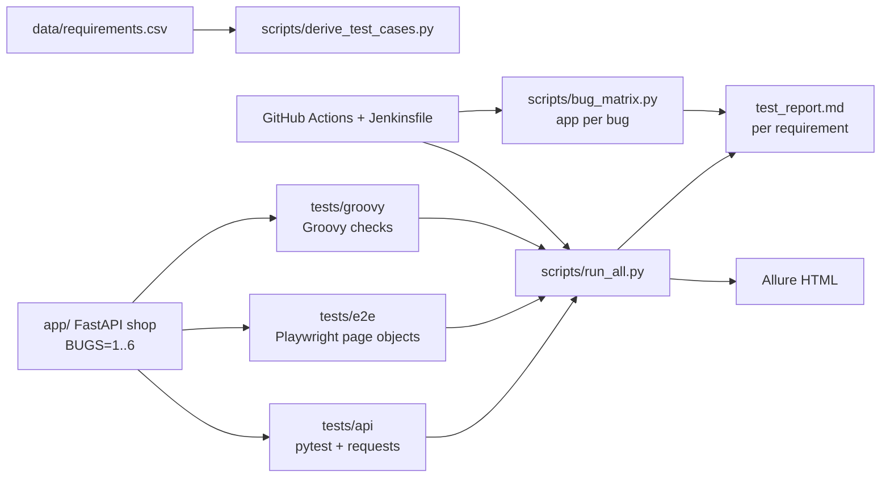

# QA Automation Lab

Test automation framework for a **small synthetic web shop** (FastAPI + HTML). Covers API tests (pytest + requests), E2E tests (Playwright, page objects), Groovy checks, requirement-based reporting, Allure, a Jenkinsfile and a GitHub Actions pipeline. Six seeded bugs prove the tests catch real defects.



## Run (CI does all of this)

```bash
pip install -r requirements.txt && python -m playwright install chromium
uvicorn app.main:app --port 8000 &
python -m scripts.bug_matrix && python -m scripts.run_all --wait
```

## Results (measured in GitHub Actions)

<!-- RESULTS:START -->
Filled automatically from the CI run artifact by `scripts/update_readme.py`.
<!-- RESULTS:END -->

## Seeded bugs

See [docs/bugs](docs/bugs) for one filled bug report per seeded bug and [docs/bug_report_template.md](docs/bug_report_template.md).

## Honest notes

- The shop is **synthetic**: invented products, users and orders. No real customer system or customer data is involved.
- The bugs are seeded by the same project that tests for them, so 6 of 6 shows the tests catch these known defects, not every possible defect.
- The Jenkinsfile is linted in CI, not executed on a Jenkins server. GitHub Actions runs the same stages.
